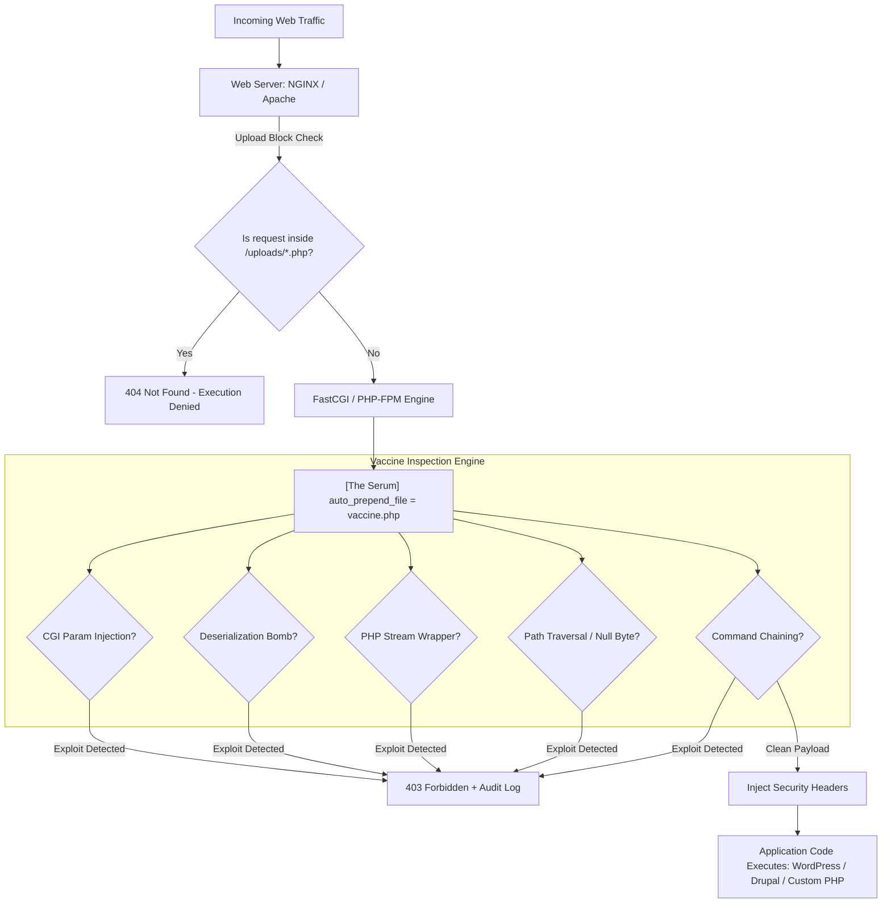

# 🛡️ PHP Universal Security Vaccine & Runtime Guardrail

[](LICENSE)
[](https://php.net)
[]()
[]()

> **A 1-shot ambient runtime "vaccine" that immunizes legacy and modern PHP web servers against global CVEs, web shells, and deserialization exploits—without modifying a single line of application source code.**

---

## 📌 The Problem: A Global Legacy PHP Crisis

Over **75% of the active internet** runs on PHP (WordPress, Drupal, Joomla, custom enterprise monoliths). Tens of millions of these systems run on **End-Of-Life (EOL)** PHP versions (5.6, 7.0–7.4) where upstream security patches no longer exist. Rewriting or refactoring these legacy applications costs billions of dollars and years of effort.

---

## 💉 The Solution: The "1-Shot Vaccine" Architecture

Instead of rewriting application files, the **PHP Universal Vaccine** introduces an ambient **Runtime Application Self-Protection (RASP)** layer that loads into memory **before any application script compiles or executes**.



---

## 🚀 Quick Start: 1-Shot Online Inoculation (Zero Git Clone Required)

Inoculate any Linux server across all active PHP versions (5.6 - 8.4+) and web servers (NGINX, Apache, LiteSpeed) directly over the internet:

```bash
# 1-Line Universal Online Inoculator
curl -sSL https://raw.githubusercontent.com/ayushpandey-futureAI/PHP_GLOBAL_SECURITY_GUARDRAIL/main/scripts/inoculate.sh | sudo bash
```

### 🔄 Continuous Online Auto-Patching (Zero-Day Protection)
To automatically receive dynamic threat signature updates and CVE hot-patches daily without server restarts:

```bash
curl -sSL https://raw.githubusercontent.com/ayushpandey-futureAI/PHP_GLOBAL_SECURITY_GUARDRAIL/main/scripts/inoculate.sh | sudo bash -s -- --auto-patch
```

### 🔍 Live Remote Security & Immunization Scanner
Remotely test any live domain for PHP vulnerabilities and check if the vaccine is active:

```bash
python3 scripts/online_scanner.py https://your-website.com
```

### 🖥️ Central Fleet Management Web Console
Launch the central fleet telemetry dashboard and REST API online:

```bash
bash scripts/serve_console.sh --port 8080
```

### 🧪 Audit-Only Mode (Testing / Staging)
To log threats to `/var/log/php-vaccine.log` without dropping traffic (HTTP 403):
```bash
sudo bash scripts/inoculate.sh --audit-only
```

---

## 🛡️ Immunization Matrix

| Vulnerability Class | Notable CVE / Vector | Vaccine Defense Mechanism | Result |
|---|---|---|---|
| **CGI Parameter Tampering** | CVE-2024-4577, CVE-2012-1823 | Intercepts `-d allow_url_include` and `-d auto_prepend_file` in query strings | `403 Forbidden` |
| **PHP Object Injection** | Deserialization gadget chains | Deep-scans inputs for `O:\d+:`, `a:\d+:`, `C:\d+:` serialized objects | `403 Forbidden` |
| **Stream Wrapper RFI / LFI** | `php://input`, `data://text/plain` | Traps arbitrary stream wrappers in `$_GET`, `$_POST`, `$_REQUEST` | `403 Forbidden` |
| **Path Traversal & Poisoning** | `../../etc/passwd`, `%00` null byte | URI and query string path normalization | `403 Forbidden` |
| **Command Injection Chaining** | `; cat /etc/passwd`, `| whoami` | Shell chaining separator and binary probe detection | `403 Forbidden` |
| **Uploaded Web Shells** | Hacker uploads `shell.php` into media | Web server configuration drop forbids `.php` execution in uploads | `404 Not Found` |
| **Missing Security Headers** | Clickjacking & MIME-type sniffing | Injects `X-Frame-Options: SAMEORIGIN` & `X-Content-Type-Options: nosniff` | Headers Added |

---

## 📊 Benchmark & Overhead (20,000 Iteration Empirical Profile)

* **Throughput Capacity:** **> 60,000 payload inspections / second**
* **Mean Latency Overhead:** **15.81 µs (0.0158 ms)** per request.
* **Median Latency (p50):** **10.58 µs (0.0106 ms)**
* **95th Percentile (p95):** **48.89 µs (0.0489 ms)**
* **Memory Footprint:** `< 120KB` per worker thread.
* **Compatibility Tested:**
  * PHP: `5.6`, `7.0`, `7.2`, `7.4`, `8.0`, `8.1`, `8.2`, `8.3`, `8.4+`
  * Engines: PHP-FPM, Apache `mod_php`, NGINX FastCGI, LiteSpeed
  * CMS Frameworks: WordPress 4.x–6.x, Drupal 7–10, Joomla, Laravel 5–11

---

## 📚 Technical & Business Operations Documentation

* **[Technical Architecture & Specification](docs/TECHNICAL_SPECIFICATION.md):** Deep 8-section technical breakdown covering NGINX upload isolation, de-obfuscation algorithms, Snuffleupagus opcode rules, MySQL polyfills, and ArcSight CEF syslog formatters.
* **[Business Operations Manual](docs/BUSINESS_OPERATIONS.md):** Complete enterprise ops guide with TCO analysis, compliance crosswalks (PCI-DSS 4.0, SOC 2, HIPAA, ISO 27001), 99.999% SLA definitions, and SOP rollout/rollback protocols.
* **[30-Year Threat Intelligence Report](docs/reports/THREAT_INTELLIGENCE_REPORT.md):** Comprehensive retrospective on PHP exploitation patterns from 1995 to 2026.

---

## 🧪 Automated Verification Suite

Run the complete multi-tiered validation battery:

```bash
# 1. Threat Model Schema Validator (46 tests)
python3 scripts/validate_threat_model.py

# 2. 50+ Exploit Battery Runner (44 CVE vectors)
python3 tests/test_exploit_vectors.py

# 3. Benign CMS Traffic & False Positive Battery (21 real-world tests)
python3 tests/test_false_positives.py

# 4. Enterprise SIEM & ArcSight CEF Formatter Test
python3 tests/test_siem_logging.py

# 5. WordPress MU-Plugin Bridge Validator
python3 tests/test_wordpress_mu_plugin_bridge.py

# 6. Microsecond Performance Benchmark (20,000 iterations)
python3 tests/benchmark_performance.py
```

---

## 📋 Scrum & Development Roadmap

Project planning, user stories, and agile sprints are documented in [JIRA_SPRINTS.md](JIRA_SPRINTS.md).
* **Sprint 1 (Done):** Core Serum (`vaccine.php`), 1-Shot Inoculator (`inoculate.sh`), Test Harness, Continuous Sync.
* **Sprint 2 (Done):** Declarative JSON Threat Schema, 50+ Exploit Battery, Legacy `mysql_*` Polyfill, Benchmark Engine.
* **Sprint 3 (Done):** Snuffleupagus Kernel Hardening, WordPress MU-Plugin Dashboard, Docker Turnkey Stack, SIEM CEF Emitter.
* **Sprint 4 (Planned):** Linux eBPF Kernel Probe, AWS Lambda Serverless Layer, Cloudflare Edge Wasm Shim, Ansible Fleet Rollout.
* **Sprint 5 (Backlog):** Autonomous AI Threat Synthesizer & Dynamic EPSS Scoring.
* **Sprint 6 (Backlog):** Multi-Tenant Enterprise Console & Automated Compliance Evidence Generator.

---

## 👤 Author & Maintainer
* **Author:** Ayush Pandey ([@ayushpandey-futureAI](https://github.com/ayushpandey-futureAI))
* **Collaborator:** Bhaskar ([Bhaskarauthor@gmail.com](mailto:Bhaskarauthor@gmail.com))
* **License:** Apache License 2.0
